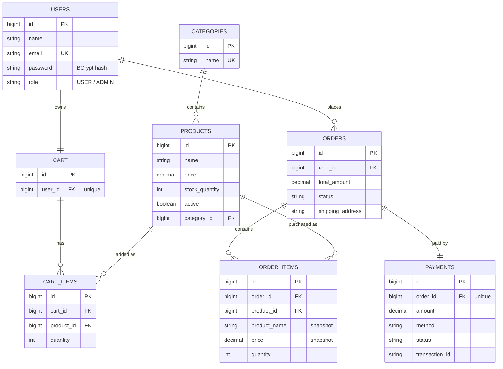

# E-Commerce Management System

A full-stack e-commerce application built with **Java 17, Spring Boot 3, Spring Security (JWT), Spring Data JPA / Hibernate and PostgreSQL**. It covers the complete shopping flow: registration and login, product catalogue with search / filter / pagination, shopping cart, checkout with payment processing, order history and an admin panel. A lightweight HTML/CSS/JavaScript frontend is served by the same application, and every endpoint is documented with Swagger.

   

## Features

| Module | What it does |
|---|---|
| **User** | Register, login (JWT), view / update profile |
| **Admin** | Add, update, delete products and categories; view all orders; update order status |
| **Products** | Keyword search, category and price filters, sorting, pagination |
| **Cart** | Add / remove items, change quantity, stock-aware, one cart per user |
| **Orders** | Checkout, order history (paginated), cancel with stock restore and refund |
| **Payment** | Gateway abstraction with CARD / UPI / NET_BANKING / COD (simulated gateway, see below) |
| **Security** | BCrypt password hashing, stateless JWT auth, role-based access (`USER`, `ADMIN`) |

### Engineering highlights

- **Layered architecture**: Controller -> Service -> Repository -> Entity, with DTOs (Java records) so entities are never exposed.
- **JPA relationships**: One-to-Many / Many-to-One (`Category` -> `Product`, `Order` -> `OrderItem`, `Cart` -> `CartItem`) and One-to-One (`User` -> `Cart`, `Order` -> `Payment`).
- **Transaction management**: checkout (stock deduction + order + payment + clear cart) is one `@Transactional` unit. If payment is declined, everything rolls back.
- **Concurrency safety**: pessimistic row locks (`SELECT ... FOR UPDATE`) on products during checkout, locked in id order to avoid deadlocks, plus optimistic locking (`@Version`) as a second guard against overselling.
- **Validation**: Jakarta Bean Validation on all request DTOs, with field-level error messages.
- **Global exception handling**: one `@RestControllerAdvice` returns a uniform JSON error body for every failure (400/401/403/404/409/402/500). Security errors (401/403) use the same format.
- **Dynamic search**: JPA `Specification` builds the `WHERE` clause from whichever filters are supplied; sort fields are whitelisted.
- **Price snapshots**: `order_items` stores the unit price and product name at purchase time, so later price changes never alter past orders.
- **Soft delete**: products appearing in old orders are hidden, not removed.
- **API docs**: Swagger UI with a JWT "Authorize" button.
- **Tests**: end-to-end MockMvc tests (register -> login -> admin creates product -> cart -> checkout -> cancel, plus payment-failure rollback, auth and validation cases) on an in-memory H2 database.
- **CI**: GitHub Actions builds and tests on every push.

## Tech stack

Java 17 · Spring Boot 3.3 · Spring MVC · Spring Security · JWT (jjwt) · Spring Data JPA · Hibernate · PostgreSQL · H2 (tests / demo) · springdoc-openapi (Swagger) · Maven · HTML/CSS/JavaScript · Postman · Git/GitHub

## Database design



Tables are created automatically by Hibernate (`spring.jpa.hibernate.ddl-auto=update`).

## Getting started

### Prerequisites
JDK 17+, Maven 3.9+ (or use STS / IntelliJ), and either PostgreSQL or Docker.

### Option A - with PostgreSQL (recommended)

```bash
git clone https://github.com/YOUR-USERNAME/ecommerce-management-system.git
cd ecommerce-management-system

docker compose up -d          # starts PostgreSQL on :5432 (db: ecommerce_db)
# or create the database manually:  CREATE DATABASE ecommerce_db;

mvn spring-boot:run
```

### Option B - no database setup (in-memory H2)

```bash
mvn spring-boot:run -Dspring-boot.run.profiles=h2
```

Then open:

| URL | What |
|---|---|
| http://localhost:8080 | Web UI |
| http://localhost:8080/swagger-ui.html | Swagger API docs |

**Run in STS / Eclipse:** `File -> Import -> Existing Maven Projects`, then right-click `EcommerceApplication` -> *Run As -> Spring Boot App*.

### Default admin account

On first start the app creates an admin and a demo catalogue.

| Email | Password |
|---|---|
| `admin@ecommerce.com` | `Admin@123` |

Change these (and the JWT secret) for any real deployment.

### Configuration (environment variables)

| Variable | Default | Purpose |
|---|---|---|
| `DB_URL` | `jdbc:postgresql://localhost:5432/ecommerce_db` | Database URL |
| `DB_USERNAME` / `DB_PASSWORD` | `postgres` / `postgres` | Database credentials |
| `JWT_SECRET` | dev-only value | HMAC signing key, **at least 32 characters** |
| `JWT_EXPIRATION_MS` | `86400000` (24 h) | Token lifetime |
| `ADMIN_EMAIL` / `ADMIN_PASSWORD` | `admin@ecommerce.com` / `Admin@123` | Seeded admin |

## API overview

Authenticated endpoints need the header `Authorization: Bearer <token>`.

| Method | Endpoint | Access | Description |
|---|---|---|---|
| POST | `/api/auth/register` | public | Create account, returns JWT |
| POST | `/api/auth/login` | public | Log in, returns JWT |
| GET / PUT | `/api/users/me` | user | View / update profile |
| GET | `/api/categories`, `/api/categories/{id}` | public | List / get categories |
| GET | `/api/products` | public | Search: `keyword, categoryId, minPrice, maxPrice, page, size, sortBy, direction` |
| GET | `/api/products/{id}` | public | Product details |
| GET | `/api/cart` | user | View cart |
| POST | `/api/cart/items` | user | Add item `{productId, quantity}` |
| PUT / DELETE | `/api/cart/items/{productId}` | user | Change quantity / remove |
| DELETE | `/api/cart` | user | Empty cart |
| POST | `/api/orders` | user | Checkout `{shippingAddress, paymentMethod}` |
| GET | `/api/orders`, `/api/orders/{id}` | user | Order history / details |
| POST | `/api/orders/{id}/cancel` | user | Cancel (restores stock, refunds) |
| POST / PUT / DELETE | `/api/admin/categories[/{id}]` | admin | Manage categories |
| POST / PUT / DELETE | `/api/admin/products[/{id}]` | admin | Manage products |
| GET | `/api/admin/orders` | admin | All orders (filter by `status`) |
| PATCH | `/api/admin/orders/{id}/status` | admin | Update order status |

### Quick demo with curl

```bash
# 1. register
curl -s -X POST localhost:8080/api/auth/register -H 'Content-Type: application/json' \
  -d '{"name":"Asha","email":"asha@example.com","password":"Password@123"}'

# 2. search products (public)
curl -s 'localhost:8080/api/products?keyword=java&sortBy=price&direction=asc'

# 3. add to cart and check out (replace TOKEN)
curl -s -X POST localhost:8080/api/cart/items -H "Authorization: Bearer TOKEN" \
  -H 'Content-Type: application/json' -d '{"productId":1,"quantity":2}'
curl -s -X POST localhost:8080/api/orders -H "Authorization: Bearer TOKEN" \
  -H 'Content-Type: application/json' -d '{"shippingAddress":"12 MG Road, Bengaluru","paymentMethod":"UPI"}'
```

## Project structure

```
src/main/java/com/ecommerce
├── config/        SecurityConfig, OpenApiConfig, DataInitializer (admin + demo data)
├── controller/    REST controllers (public, user, admin)
├── dto/           Request / response records with validation annotations
├── entity/        JPA entities and enums
├── exception/     Custom exceptions + GlobalExceptionHandler
├── mapper/        Entity -> DTO conversion
├── repository/    Spring Data JPA repositories + product Specifications
├── security/      JWT service, auth filter, UserDetails, 401/403 handlers
└── service/       Business logic (auth, cart, orders, payment, ...)
```

## Payment integration note

Checkout talks to a `PaymentGateway` interface. The bundled `MockPaymentGateway` simulates a provider (it approves payments, and declines amounts above ₹10,00,000 so the failure/rollback path can be demonstrated); **no real money moves**. To go live, implement `PaymentGateway` with a provider such as Razorpay or Stripe (create order -> verify the payment signature -> record the transaction id) and register it as the Spring bean; no order or cart code needs to change.

## How the main flows work (interview cheat-sheet)

- **Login**: `AuthController` -> `AuthService` -> `AuthenticationManager` checks the BCrypt hash -> `JwtService` signs a token with the user's email, id and role.
- **Every protected request**: `JwtAuthenticationFilter` reads the Bearer token, verifies signature and expiry, loads the user and places it in the `SecurityContext`. `SecurityConfig` then applies the URL rules (`/api/admin/**` needs `ROLE_ADMIN`); `@PreAuthorize` repeats this at method level.
- **Checkout** (`OrderService.placeOrder`): load cart -> lock each product row -> verify stock -> deduct stock -> create order + items with price snapshots -> `PaymentService` charges the gateway -> mark `PAID` -> clear cart. One transaction, so a payment failure undoes everything.
- **Cancel**: only `PLACED`/`PAID` orders; stock is added back and the payment is marked `REFUNDED`.
- **Why DTOs**: the API contract stays stable and sensitive fields (password hash) can never leak.
- **Why `open-in-view=false`**: forces lazy loading to happen inside service transactions, avoiding hidden queries in the web layer.

## Running tests

```bash
mvn verify
```

## Ideas for next steps

Product images upload, refresh tokens, email notifications, Redis caching for the catalogue, Docker image + deployment (Render / AWS), a React frontend, real Razorpay integration.

## Resume entry

**E-Commerce Management System** | Java, Spring Boot, Spring Security, JWT, PostgreSQL, Hibernate

- Built a full-stack e-commerce application with RESTful APIs for authentication, product management, cart, checkout and order tracking.
- Implemented stateless JWT authentication with BCrypt hashing and role-based access control (USER / ADMIN) using Spring Security.
- Designed a normalized 8-table PostgreSQL schema with JPA/Hibernate One-to-Many, Many-to-One and One-to-One mappings.
- Implemented transactional checkout with pessimistic locking to prevent overselling and automatic rollback on payment failure.
- Added pagination, dynamic search/filtering with JPA Specifications, DTO validation, global exception handling, Swagger documentation, integration tests and a GitHub Actions CI pipeline.
